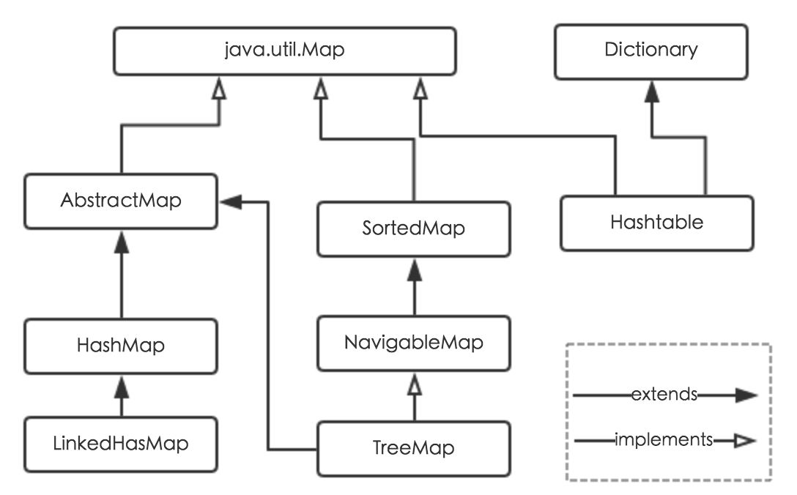
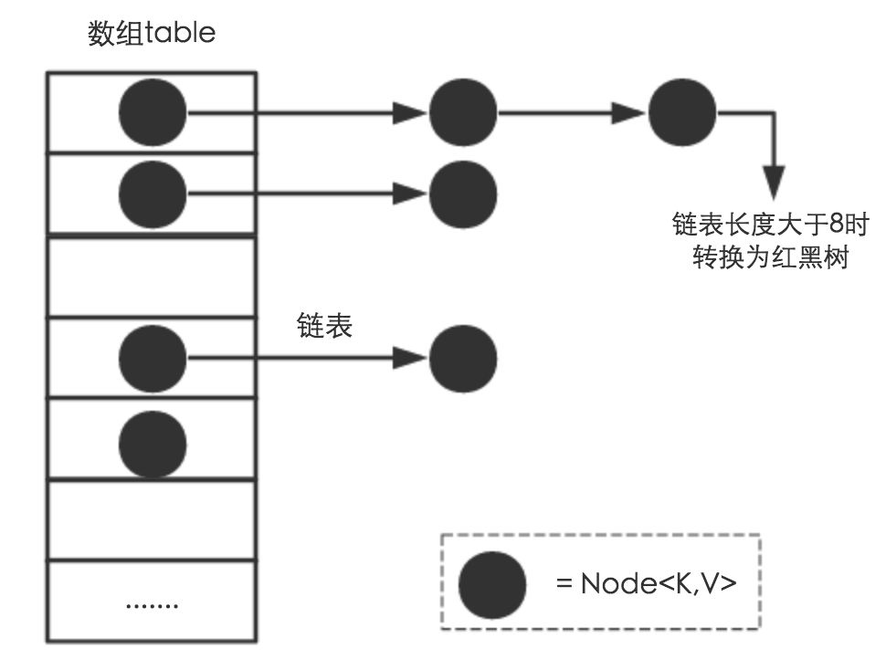

# HashMap详解
面试一直被问 HashMap，被问多少次就不知道多少次。。。看下HashMap的结构
https://zhuanlan.zhihu.com/p/21673805
这是知乎高赞的帖子，写的挺好的。

简介
Java为数据结构中的映射定义了一个接口java.util.Map，此接口主要有四个常用的实现类，分别是HashMap、Hashtable、LinkedHashMap和TreeMap，类继承关系如下图所示：



## 内部实现
搞清楚HashMap，首先需要知道HashMap是什么，即它的存储结构-字段；其次弄明白它能干什么，即它的功能实现-方法。下面我们针对这两个方面详细展开讲解。

## 存储结构-字段
从结构实现来讲，HashMap是数组+链表+红黑树（JDK1.8增加了红黑树部分）实现的，如下如所示。

这里需要讲明白两个问题：数据底层具体存储的是什么？这样的存储方式有什么优点呢？

(1) 从源码可知，HashMap类中有一个非常重要的字段，就是 **Node[] table，即哈希桶数组，明显它是一个Node的数组**。我们来看Node[JDK1.8]是何物。
```java
static class Node<K,V> implements Map.Entry<K,V> {
        final int hash;    //用来定位数组索引位置
        final K key;
        V value;
        Node<K,V> next;   //链表的下一个node

        Node(int hash, K key, V value, Node<K,V> next) { ... }
        public final K getKey(){ ... }
        public final V getValue() { ... }
        public final String toString() { ... }
        public final int hashCode() { ... }
        public final V setValue(V newValue) { ... }
        public final boolean equals(Object o) { ... }
}
```
Node是HashMap的一个内部类，实现了Map.Entry接口，**本质是就是一个映射(键值对)**。上图中的每个黑色圆点就是一个Node对象。

(2) HashMap就是使用**哈希表**来存储的。哈希表为解决冲突，可以采用**开放地址法**和**链地址法**等来解决问题，Java中HashMap采用了**链地址法**。链地址法，简单来说，就是**数组加链表的结合**。在每个数组元素上都一个链表结构，当数据被Hash后，得到数组下标，把数据放在对应下标元素的链表上。例如程序执行下面代码：
```java
map.put("美团","小美");
```
系统将调用"美团"这个key的hashCode()方法得到其hashCode 值（该方法适用于每个Java对象），然后再通过Hash算法的后两步运算（高位运算和取模运算，下文有介绍）来定位该键值对的存储位置，有时两个key会定位到相同的位置，表示发生了Hash碰撞。当然Hash算法计算结果越分散均匀，Hash碰撞的概率就越小，map的存取效率就会越高。

如果哈希桶数组很大，即使较差的Hash算法也会比较分散，如果哈希桶数组数组很小，即使好的Hash算法也会出现较多碰撞，所以就需要在空间成本和时间成本之间权衡，其实就是在根据实际情况确定哈希桶数组的大小，并在此基础上设计好的hash算法减少Hash碰撞。那么通过什么方式来控制map使得Hash碰撞的概率又小，哈希桶数组（Node[] table）占用空间又少呢？答案就是好的Hash算法和扩容机制。

在理解Hash和扩容流程之前，我们得先了解下HashMap的几个字段。从HashMap的默认构造函数源码可知，构造函数就是对下面几个字段进行初始化，源码如下：
```java
     int threshold;             // 所能容纳的key-value对极限 
     final float loadFactor;    // 负载因子
     int modCount;  
     int size;
```

首先，Node[] table的初始化长度length(**默认值是16**)，Load factor为**负载因子(默认值是0.75)**，threshold是HashMap所能容纳的最大数据量的Node(键值对)个数。threshold = length * Load factor。也就是说，在数组定义好长度之后，负载因子越大，所能容纳的键值对个数越多。

结合负载因子的定义公式可知，threshold就是在此Load factor和length(数组长度)对应下允许的最大元素数目，**超过这个数目就重新resize(扩容)**，扩容后的HashMap容量是之前容量的两倍。默认的负载因子0.75是对空间和时间效率的一个平衡选择，建议大家不要修改，除非在时间和空间比较特殊的情况下，如果内存空间很多而又对时间效率要求很高，可以降低负载因子Load factor的值；相反，如果内存空间紧张而对时间效率要求不高，可以增加负载因子loadFactor的值，这个值可以大于1。